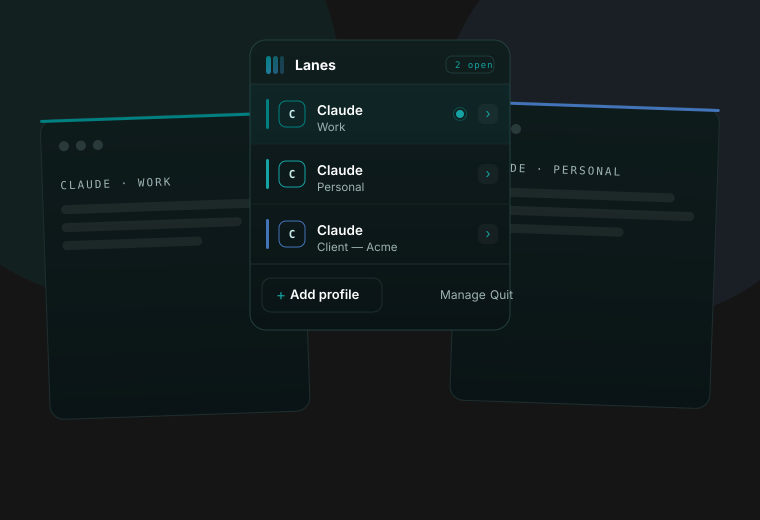

<div align="center">

# Lanes

**Two accounts. No logout.**

A tiny, free macOS menu-bar launcher that opens your AI desktop apps — each signed into a
different account, side by side. Work and personal, running at once.



<sub>Built by <a href="https://synthetixis.com">Synthetixis</a> · free &amp; open source · macOS</sub>

</div>

---

## All it does, in one line

```
/Applications/Claude.app/Contents/MacOS/Claude --user-data-dir="~/Library/Application Support/Lanes/profiles/claude-work"
```

Lanes opens the **official** app pointed at a per-profile data directory. Each profile keeps its
own session in its own folder, so two accounts run as two independent windows. That's the whole
trick — and the whole product.

## It never touches your tokens

This is the entire safety story, and it's not a slogan — it's the mechanism:

- **No token handling.** To open a lane, Lanes only *chooses a directory* and *spawns a process*.
  It never reads, copies, moves, or writes your login/session material. Other account switchers
  shuffle credentials around; Lanes doesn't have to.
- **Copying a setup skips sign-in.** *Copy Setup Between Lanes…* copies a fixed list of Claude's
  local files (settings, MCP servers, plugins, the Code and Cowork session list) and re-files them
  under the other lane's account. It never copies `config.json` (where Claude keeps its sign-in
  tokens; Lanes reads only the account and organisation IDs from it), cookies or browser storage.
  Chats and projects live on claude.ai with each account and can't be copied. This follows
  Claude's internal file layout, which an update can change (`src-tauri/src/copy.rs`).
- **No network, ever.** Zero analytics, zero phone-home, zero update checks. Lanes makes no network
  requests at all. Everything happens locally on your Mac.
- **Menu-bar only.** No Dock icon and no background services: a native macOS menu, plus a small
  window for adding and managing lanes. It's about 3 MB.
- **Open source.** Every line is here. Read it, build it yourself, or trust that others can.

## Supported apps

| App | Status | Why |
|-----|--------|-----|
| **Claude Desktop** | ✅ Supported | Electron; honors `--user-data-dir`, so each profile gets a fully isolated, persistent session. |
| ChatGPT | ❌ Not supported (v0) | Native (non-Electron) app — there's no per-profile data-dir switch to point it at. |
| Codex | ❌ Not supported (v0) | Electron, but it ignores `--user-data-dir` and writes to a fixed location, so two instances share one login. |

The app list is a single data table in [`src-tauri/src/apps.rs`](src-tauri/src/apps.rs). If a future
app version exposes a working isolation path, adding it is one line — no other code changes.

## Install

1. Download `Lanes.dmg` from [Releases](https://github.com/synthetixis/lanes/releases).
2. Open it and drag **Lanes** into your Applications folder.
3. Launch it. Lanes appears in your **menu bar** (no Dock icon).

> **First launch:** v0 builds aren't notarized by Apple yet, so macOS blocks the first open. It's a
> one-time step — **System Settings → Privacy & Security → Open Anyway**. Full walkthrough (and the
> Terminal fallback) in **[INSTALL.md](INSTALL.md)**. See [Distribution](#distribution) for the
> notarization hook that removes the prompt entirely.

## How to use

1. Click the **Lanes** icon in the menu bar. It opens a native macOS menu listing your lanes.
2. **Already signed into Claude?** Choose **Add Current Claude Session…** and give it a name
   (`Personal`, `Work`…). That existing account becomes a lane, no re-login.
3. **Add Lane…** → pick Claude, name a *new* lane, pick a colour. Sign in once per new lane.
4. Choose a lane in the menu. The real Claude app opens on that account. Choose another and they
   run side by side — the login stays put. Open lanes are ticked.
5. **Manage Lanes…** lets you rename, recolour or remove a lane. Removing a Lanes-created lane
   offers to delete its data folder, naming the exact path first. An **adopted** lane never offers
   that — removing it just drops it from Lanes and leaves your real Claude data untouched.
6. **Copy Setup Between Lanes…** makes a new lane match an existing one: same settings, MCP
   servers, plugins and Code/Cowork sessions, under the new lane's own account. Sign in to the
   new lane once and quit it first. Copied sessions keep their original folders, so both lanes
   work on the same files.

Profiles live in `~/Library/Application Support/Lanes/` (a small `lanes.json` plus one folder per
profile). Opening a lane never looks inside those folders — it just hands the path to the app.

## Build from source

Requires [Rust](https://rustup.rs) and Node.js.

```bash
npm install
npm run tauri dev      # run locally
npm run tauri build    # produce Lanes.app + a .dmg in src-tauri/target/release/bundle/
```

Stack: [Tauri v2](https://tauri.app) (Rust core + a native AppKit menu + a small webview window for managing lanes).
The privileged surface is a handful of vetted Rust commands; the UI is plain HTML/CSS/JS styled after
Appbox's Kumo theme (Cloudflare's Kumo design system with Appbox colours), with Geist bundled locally.
No UI framework, no network plugins, no auto-updater.

```
src-tauri/src/
  apps.rs        # known-apps table (data-driven) + install detection
  profiles.rs    # JSON load/save, data-dir create/delete, atomic writes
  launch.rs      # spawn the app binary directly with --user-data-dir (never `open`)
  menu.rs        # the menu-bar item and its native NSMenu (macOS)
  lib.rs         # manager window, the command surface
ui/              # index.html · panel.css · panel.js  (the manager window)
```

## Distribution

> **⚠️ Keep the release asset named `Lanes.dmg`.** The landing page links to
> `https://github.com/synthetixis/lanes/releases/latest/download/Lanes.dmg` — a permalink that always
> points at the newest release, so the site never needs editing on a new version. It only works if
> every release uploads its `.dmg` under the **exact filename `Lanes.dmg`** (rename the built
> `Lanes_x.y.z_aarch64.dmg` to `Lanes.dmg` when attaching it). Change the name and the download breaks.

To ship a build users can open without Gatekeeper friction, code-sign and notarize the `.dmg`. With
an Apple Developer ID, set the signing identity in `src-tauri/tauri.conf.json` under
`bundle.macOS.signingIdentity` and provide notarization credentials via the standard
`APPLE_ID` / `APPLE_PASSWORD` / `APPLE_TEAM_ID` environment variables, then run `npm run tauri build`.
See the [Tauri macOS signing guide](https://tauri.app/distribute/sign/macos/).

## Honest about what this is

Lanes is an **unofficial** personal-productivity utility. It is **not affiliated with, endorsed by,
or supported by Anthropic or OpenAI**. It launches official apps you already have installed; it does
not modify or repackage them.

Running multiple accounts may be subject to your plan's terms — **check them before doing so,
especially on Team or Enterprise plans.**

## License

The **source code** is **MIT** — see [LICENSE](LICENSE). Read it, build it, ship your own fork. The
**brand is reserved**, though (names, mark, logo) — see [Trademarks & brand](#trademarks--brand).

## Trademarks & brand

The MIT license covers the **source code only**. The **Lanes** and **Synthetixis** names, the ▍▍▍
Lanes mark, the Synthetixis logo, and associated brand assets are **not** licensed for reuse. Forks
and derivative works must be **rebranded** — you may not distribute a build using the Lanes name or
marks.

The landing page ([lanes.synthetixis.com](https://lanes.synthetixis.com)) lives in its own,
all-rights-reserved repo (`lanes-site`) — this repository is the app only.
